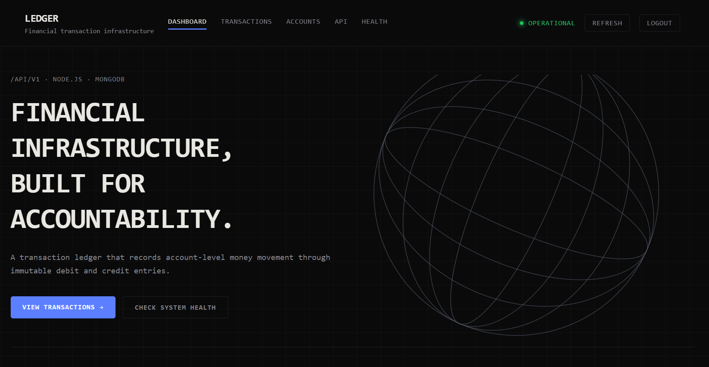
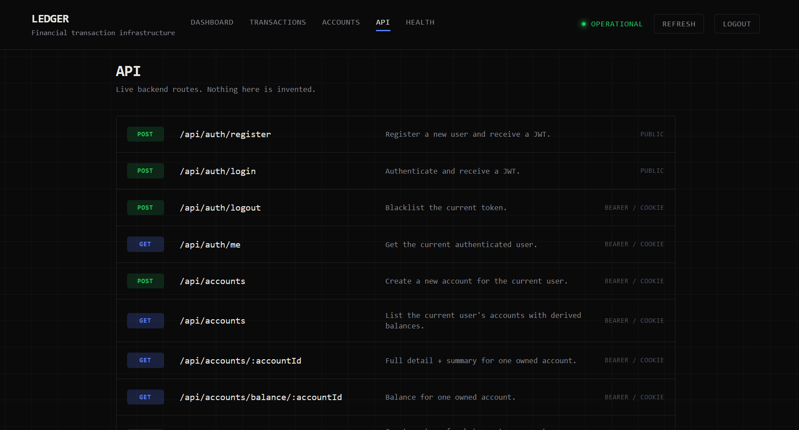
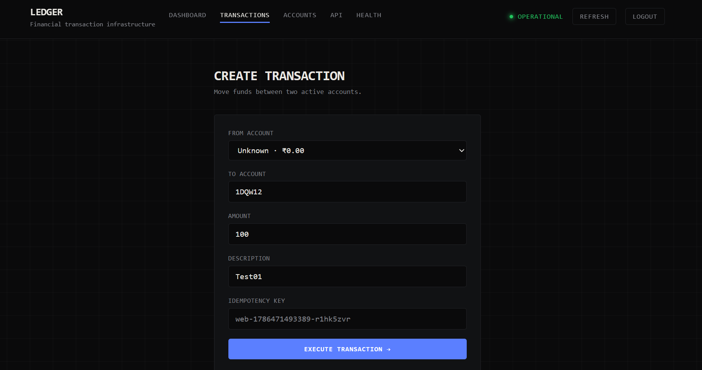

# Ledger

A lightweight payment ledger for secure account-level money movement.







## Features

- JWT authentication
- Account and balance management
- Double-entry debit/credit ledger
- Idempotent transactions
- Transaction history and reversals
- Immutable ledger entries
- API health and documentation
- Local SQLite database for development/testing

## Tech Stack

**Backend:** Node.js, Express, SQLite
**Frontend:** React, TypeScript, Vite
**Auth:** JWT, bcrypt

## Run Locally

### Backend

```bash
cd backend-ledger-main
npm install
npm run dev
```

### Frontend

```bash
cd frontend
npm install
npm run dev
```

The SQLite database is created automatically at:

`backend-ledger-main/data/ledger.db`

## Core Flow

```text
Authentication
      ↓
Accounts
      ↓
Transaction
      ↓
Debit + Credit
      ↓
Immutable Ledger
      ↓
Balance
```

> Built with a focus on reliability, consistency, and safe money movement.
